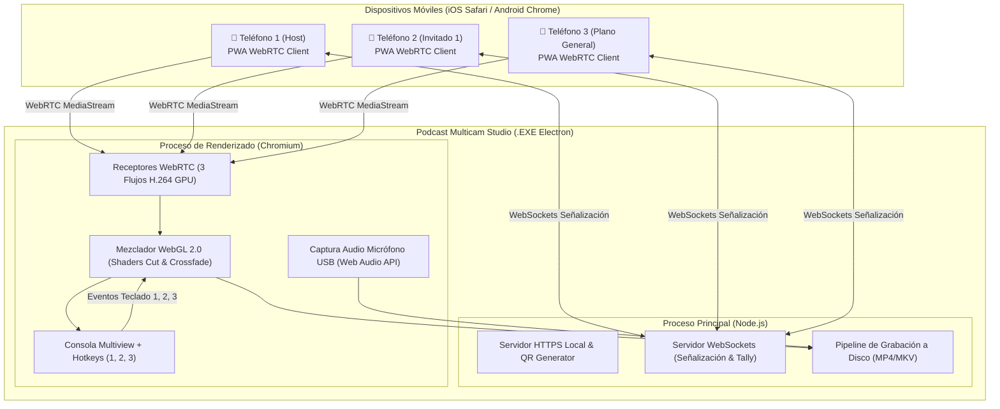

# 🏗️ Arquitectura Técnica: Podcast Multicam Studio

Documento técnico del pipeline de video, audio y renderizado para la aplicación independiente de grabación de podcast.



---

## 1. Módulos y Tecnologías del Sistema

### A. Capa de Escritorio (Desktop Core)
- **Framework:** Electron con Vite (referencia directa de `apps_desktop_compilables/Recordly`).
- **Lenguaje:** TypeScript / JavaScript moderno.
- **Estilos:** Tailwind CSS para una interfaz oscura, limpia y ergonómica de estudio de grabación.

### B. Módulo de Ingesta y WebRTC
- **Servidor Local Embebido:** Servidor HTTPS en Node.js que sirve los assets estáticos del cliente móvil a la red local.
- **Auto-Detección de Adaptadores de Red (Multi-NIC / Hotspot 5GHz):**
  - El proceso de Node.js analiza `os.networkInterfaces()` al iniciar.
  - Identifica automáticamente el adaptador activo (Ethernet, Wi-Fi 5GHz, Zona con Cobertura Móvil de Windows o Hotspot de celular) y expone un selector en la UI.
  - Los códigos QR se actualizan instantáneamente con la IP correcta (`https://<IP_LOCAL>:8443/cam/1`).
- **WebRTC Offline Directo (Host Candidates Only):**
  - Se desactiva la búsqueda de servidores STUN/TURN externos para evitar bloqueos o demoras de negociación (`iceServers: []`).
  - La conexión se establece directamente mediante paquetes UDP locales en la banda de 5GHz, alcanzando latencias de transporte de apenas **30 a 50 milisegundos**.
- **Certificado SSL Local:** Auto-generado para permitir que Safari y Chrome activen la cámara trasera mediante `getUserMedia` sin restricciones de seguridad.
- **Señalización:** WebSocket nativo (`ws`) para intercambio de SDP Offers/Answers y candidatos ICE.
- **Códec de Video:** H.264 (Baseline/High Profile) para asegurar decodificación por hardware tanto en los SoCs de Apple/Qualcomm como en la GPU de la PC.

### C. Motor Mezclador de Video (WebGL Compositor)
- Un `<canvas id="program-canvas" width="1920" height="1080">` acelerado por hardware en el proceso de renderizado.
- **Shader de Transición (GLSL)**:
  - Cuando se pulsa `1`, `2` o `3`, el programa actualiza la textura de origen y la de destino.
  - El shader realiza una interpolación lineal `mix(textureA, textureB, progress)` con curva ease-in-out durante los milisegundos seleccionados, o hace un corte directo a $t=0$.

### D. Pipeline de Audio de Estudio
- **Captura:** `navigator.mediaDevices.getUserMedia({ audio: { deviceId: micId, echoCancellation: false, noiseSuppression: false, autoGainControl: false } })`.
- **Procesamiento:** `AudioContext` en modo de alta fidelidad (48.000 Hz, 24/32-bit float sin filtros destructivos para voz de podcast).
- **Control de Retardo:** Nodo `DelayNode` configurable en milisegundos para alineación labial (Lip-sync offset).

### E. Módulo de Grabación a Disco
- **Opciones de codificación:**
  1. `MediaRecorder` nativo de Chromium con códec `video/mp4; codecs="avc1.4d002a, mp4a.40.2"` o `video/webm;codecs=h264,opus`.
  2. Subproceso de `ffmpeg.exe` local (integrado en el paquete) que recibe los frames de video y audio multiplexándolos en tiempo real a MP4 con NVENC (`-c:v h264_nvenc -preset p4 -rc vbr -cq 19`).

---

## 2. Estructura de Archivos a Desarrollar en la Carpeta

```
c:\Proyects\GITHUB_REPOS\Proyects_repo\podcast_multicam_studio\
├── README.md                  # Descripción del proyecto
├── SPEC_REQUERIMIENTOS.md     # Especificación funcional aprobada
├── ARQUITECTURA_TECNICA.md    # Este documento
├── package.json               # Dependencias de Electron, Vite y utilidades
├── vite.config.ts             # Configuración del empaquetador
├── src/
│   ├── main/                  # Proceso principal de Electron (Node.js)
│   │   ├── index.ts           # Inicialización de ventana nativa
│   │   ├── server.ts          # Servidor HTTPS + WebSocket local
│   │   └── qr.ts              # Generador de códigos QR para la LAN
│   ├── renderer/              # Interfaz de la PC (Consola del Director)
│   │   ├── index.html         # Vista principal
│   │   ├── App.tsx            # Componente de la Consola
│   │   ├── components/
│   │   │   ├── Multiview.tsx  # Cuadrícula 3 cámaras + Program
│   │   │   ├── AudioMeter.tsx # Vúmetro en tiempo real
│   │   │   └── TopBar.tsx     # Botón Grabar, Reloj y QR modal
│   │   ├── engine/
│   │   │   ├── webrtc-mgr.ts  # Manejador de las 3 conexiones WebRTC
│   │   │   ├── webgl-mixer.ts # Shaders GLSL y renderizado a 60 FPS
│   │   │   └── recorder.ts    # Pipeline de grabación a disco
│   │   └── hooks/
│   │       └── useHotkeys.ts  # Atajos de teclado (1, 2, 3, Fade, Space)
│   └── mobile/                # Cliente PWA para los teléfonos
│       ├── index.html         # Interfaz para iPhone y Android
│       ├── mobile.ts          # Captura cámara trasera, WakeLock, OLED Mode
│       └── style.css          # Estilos Tally (bordes rojo/verde/negro)
```
