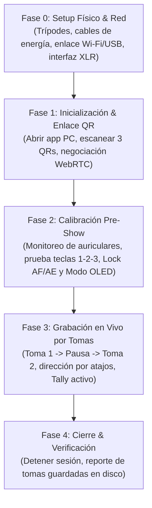

# 🔄 Flujo Operativo y Ciclo de Vida del Sistema: Podcast Multicam Studio

Documento rector del ciclo operativo, máquina de estados, telemetría y reglas de contingencia para la producción de podcast multicámara.

---

## 1. 👥 Roles y Dinámica de Producción

El sistema está diseñado para un esquema de producción profesional de dos niveles:
- **En la Mesa (Talento):** El Host y los Invitados se concentran 100% en la conversación, guiados visualmente por las **luces Tally** en las pantallas de los teléfonos.
- **En la Consola (Director Técnico):** Un operador dedicado en la PC se encarga del switching de cámaras por teclado (`1`, `2`, `3`), supervisa la salud del sistema (baterías, latencias, FPS), monitorea el audio por auriculares y gestiona las **tomas numeradas**.

---

## 2. 📋 El Ciclo de Vida Completo (User Flow Cronológico)

### Fase 0: Setup Físico y de Red (Pre-producción)
1. **Montaje:** Se ubican los 3 teléfonos en sus respectivos trípodes:
   - Teléfono 1: Plano del Host / Conductor.
   - Teléfono 2: Plano del Invitado.
   - Teléfono 3: Plano General / Reacciones (ambos en cuadro).
2. **Energía:** Se conectan los teléfonos a sus cargadores para asegurar autonomía ilimitada.
3. **Red:** Los teléfonos se conectan al Wi-Fi 5GHz exclusivo del set o a los cables USB puenteados a la PC.
4. **Audio:** Se conecta la interfaz de sonido USB/XLR a la PC (ej. Focusrite, Behringer, Rode, Shure) y los auriculares del operador.

### Fase 1: Inicialización & Enlace QR
1. El director abre la app de escritorio `Podcast Multicam Studio`.
2. El servidor local HTTPS y WebSockets arranca en el puerto local (ej. `8443`).
3. La consola muestra las 3 ranuras en estado `ESPERANDO CONEXIÓN...`.
4. El director hace clic en `[ 📱 Conectar Cámaras ]` para abrir el modal con los códigos QR.
5. Se escanea cada código con la cámara nativa del iPhone/Android:
   - Se abre la web local segura en Safari o Chrome.
   - Al aceptar permisos, se activa la cámara trasera en 1080p, se activa *Screen Wake Lock* (evita que la pantalla se apague) y se establece el canal WebRTC P2P en menos de 1 segundo.
6. En la PC, los 3 monitores multivista se iluminan en vivo, mostrando FPS reales, resolución 1080p, latencia en ms y porcentaje de batería.

### Fase 2: Calibración Pre-Show (2 minutos antes de grabar)
1. **Monitoreo de Auriculares del Operador:**
   - El director activa el canal de monitoreo en la app y escucha con sus auriculares lo que entra a la PC, regulando el volumen con el deslizador de monitoreo.
   - Se confirma que el vúmetro estéreo module en la zona óptima (-18 dB a -12 dB).
2. **Bloqueo Óptico:**
   - En cada móvil se toca `[ 🔒 Lock AF/AE ]` para congelar el enfoque y la exposición fija (evita bombeos de enfoque por gestos).
3. **Prueba de Switching:**
   - El director presiona `1`, `2`, `3` en el teclado: verifica que el monitor grande **PROGRAM** cambie de toma y que los marcos Tally de los teléfonos cambien de color.
4. **Modo Ahorro Térmico:**
   - En cada móvil se toca `[ 🌙 Modo OLED ]`: la pantalla se apaga a negro casi absoluto con una línea sutil de Tally para no recalentar el dispositivo en grabaciones de 1 a 2 horas.

### Fase 3: Grabación en Vivo por Tomas (El Show)
1. **Inicio de la Toma 1:**
   - El director pulsa **[ ● GRABAR TOMA ]** (o `Ctrl + R`).
   - El archivo se nombra automáticamente: `Episodio_Toma_01.mp4`.
   - El timecode arranca (`00:00:01`) y el encoder NVENC por hardware empieza a escribir el archivo en disco.
2. **Dinámica de Dirección:**
   - Habla el Host -> Tecla `1` (Corte directo). El marco del iPhone 1 se ilumina en **Rojo Brillante (ON AIR)**.
   - Habla el Invitado -> Tecla `2` (Disolvencia suave). El marco del teléfono 2 se ilumina en Rojo.
   - Interacción conjunta -> Tecla `3` (Plano general).
3. **Pausas y Cortes (Generación de Nueva Toma):**
   - Si los participantes necesitan hidratarse, revisar notas o hacer una pausa, el director pulsa **[ ■ CORTAR TOMA ]** (o `Espacio + Enter`).
   - El archivo `Episodio_Toma_01.mp4` se sella y queda listo en disco.
   - Al retomar, se pulsa **[ ● NUEVA TOMA ]** y se inicia inmediatamente `Episodio_Toma_02.mp4` sin reiniciar nada en la app ni en los teléfonos.

### Fase 4: Cierre y Sellado de Archivos
1. Finalizado el podcast completo, se pulsa **[ FINALIZAR SESIÓN ]**.
2. La app genera un resumen interactivo:
   - *Toma 01:* `00:42:15` (3.4 GB)
   - *Toma 02:* `00:35:10` (2.8 GB)
3. Botón directo: `[ 📂 Abrir Carpeta de Grabaciones ]` con los archivos ordenados cronológicamente listos para post-producción.

---

## 3. ⚙️ Análisis Técnico: Grabación Master vs Grabación ISO

El usuario planteó la duda sobre el impacto de la **Grabación ISO (grabar las 3 cámaras por separado en simultáneo además del Master)**:

| Criterio | Solo Grabación Master (Recomendado) | Grabación Master + ISO (3 Cámaras) |
| :--- | :--- | :--- |
| **Flujos a codificar** | **1 flujo** (La salida switcheada) | **4 flujos simultáneos** (Master + Cam 1 + Cam 2 + Cam 3) |
| **Uso de Sesiones NVENC (GPU)** | 1 sesión (cualquier GPU Nvidia GTX/RTX lo hace al 5% de carga) | 4 sesiones simultáneas (exige GPU RTX con soporte multi-encode) |
| **Tasa de Escritura a Disco** | ~10 MB/s (Cualquier SSD o disco duro SATA lo soporta con holgura) | ~40 MB/s (Requiere SSD NVMe para evitar cuellos de botella) |
| **Espacio por 1 hora** | ~4.5 GB totales | ~18 GB totales |
| **Decisión de Arquitectura** | **Modo por defecto ultraligero.** | **Toggle opcional en Configuración:** `[ ] Activar Grabación ISO multi-cámara`, disponible si la PC cuenta con GPU potente. |

---

## 4. 🛡️ Matriz de Resiliencia y Casos Borde (Failsafes)

| Escenario de Falla | Detección del Sistema | Acción Automática Inmediata |
| :--- | :--- | :--- |
| **Un teléfono se apaga o pierde conexión estando AL AIRE** | El canal WebRTC emite desconexión (`disconnected`). | Si esa cámara estaba en **PROGRAM**, el sistema conmuta automáticamente a **Cámara 3 (Plano General)** en 0 ms. La grabación **NO se detiene**. En la PC se muestra advertencia amarilla. |
| **Caída momentánea de red (2-3 segundos)** | Detección de pérdida de paquetes ICE. | El compositor mantiene el último cuadro válido en pantalla mientras la reconexión ICE reanuda el flujo en segundo plano de manera transparente. |
| **Desconexión accidental del micrófono USB de la PC** | `ondevicechange` en la Web Audio API. | Alerta visual roja en la barra superior y conmutación automática de emergencia al micrófono del teléfono que esté actualmente en vivo para evitar audio mudo. |
| **Corte de energía repentino en la PC** | Apagado violento del sistema. | El contenedor MP4 fragmentado (`empty_moov + frag_keyframe`) garantiza que todos los minutos previos al corte queden legibles y rescatables en disco. |
| **Espacio bajo en disco duro (< 10 GB)** | Sondeo continuo del filesystem local. | Advertencia amarilla al llegar a 15 GB; alarma sonora y visual al bajar de 5 GB para avisar al director. |

---

## 5. 🎛️ Tabla de Atajos de Teclado del Switcher

| Atajo | Acción | Tipo de Transición |
| :--- | :--- | :--- |
| **`1`** | Conmuta a Cámara 1 (Host) | Corte seco directo (0 ms) |
| **`2`** | Conmuta a Cámara 2 (Invitado) | Corte seco directo (0 ms) |
| **`3`** | Conmuta a Cámara 3 (General) | Corte seco directo (0 ms) |
| **`Shift + 1`** | Conmuta a Cámara 1 | Disolvencia suave (Fade 300 ms) |
| **`Shift + 2`** | Conmuta a Cámara 2 | Disolvencia suave (Fade 300 ms) |
| **`Shift + 3`** | Conmuta a Cámara 3 | Disolvencia suave (Fade 300 ms) |
| **`Espacio`** | Alterna entre plano individual y plano general | Disolvencia rápida (150 ms) |
| **`Ctrl + R`** | Iniciar / Cortar Toma actual | - |
| **`M`** | Silenciar / Activar micrófono Master (Mute de emergencia) | Inmediato |
| **`H`** | Activar / Desactivar Monitoreo de Auriculares del Operador | Inmediato |
