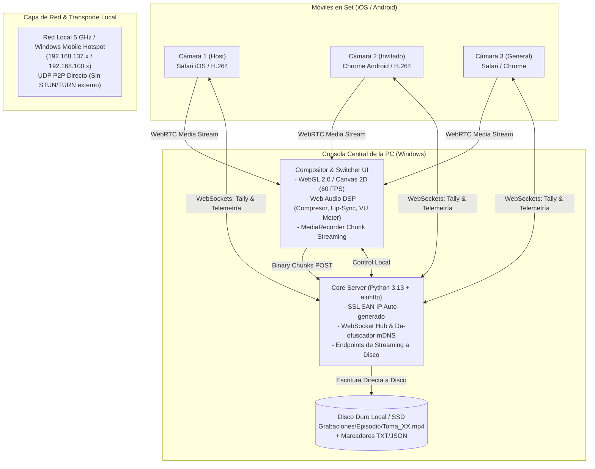
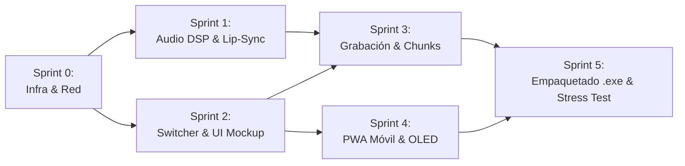

# 📐 Arquitectura de Infraestructura y Plan de Sprints Técnicos
**Proyecto:** Podcast Multicam Studio (Director Console & Multicam WebRTC Ingest)  
**Versión de Plan:** 1.0.0-PROD  
**Fecha:** 26 de Octubre de 2026  
**Enfoque:** Tareas atómicas, sin alucinaciones, con criterio estricto de aceptación ("Definition of Done").

---

## 🏗️ 1. Definición Formal de Infraestructura y Stack Tecnológico

Para asegurar que el sistema sea 100% autónomo (sin OBS, sin nube, sin pagos de suscripción y con cero dependencia de Internet), se formalizan las decisiones técnicas:

### Tabla de Decisiones Tecnológicas (Tech Stack Matrix)

| Componente | Tecnología Seleccionada | Justificación Técnica | Alternativas Descartadas |
| :--- | :--- | :--- | :--- |
| **Frontend & UI Core** | **Angular 19 (Standalone + Signals)** | Arquitectura modular con tipado estricto TypeScript, servicios inyectables (`@Injectable`), cero NgModules y render loop a 60 FPS fuera de zona (`runOutsideAngular`). | JavaScript monolítico en un único archivo `app.js` (difícil de mantener y escalar). |
| **Backend & Servidor Local** | **Python 3.13 + `aiohttp`** | Concurrencia asíncrona pura sin hilos bloqueantes, WebSockets integrados de alta velocidad y servidor HTTP liviano. | Flask/Django (muy pesados). |
| **Transporte de Video** | **WebRTC P2P LAN Directo** | Latencia < 60 ms. Candidatos ICE `host` con reemplazo dinámico de mDNS (`.local` -> IP LAN). | RTMP (latencia > 2s), RTSP (incompatible con Safari sin transcodificación pesada). |
| **Arquitectura de Señalización** | **WHIP Invertido (Phone = Offerer, PC = Answerer)** | Obligatorio para que iOS Safari active el codificador por hardware H.264 de Apple. | PC como Offerer (Safari ignora `replaceTrack` y envía 0 frames). |
| **Seguridad & Certificados** | **OpenSSL Dinámico (Cryptography lib)** | Generación automática en cada inicio de certificados X.509 con SAN IP exacta de la red detectada. | Certificados manuales (rompen la experiencia en redes dinámicas). |
| **Lector QR en Móvil** | **`jsQR` (Pure JS) + Canvas Viewfinder** | 100% compatible con todos los navegadores móviles sin depender de la API `BarcodeDetector` (rota en muchas versiones de iOS). | Librerías pesadas de WebAssembly o plugins nativos. |
| **Mezclador de Video** | **Canvas 2D / WebGL en GPU** | Composición a 1080p60 con transiciones matemáticas (Cut, Mix, Dip) consumiendo < 5% de GPU. | OBS WebSocket (genera dependencia de software externo). |
| **Motor de Audio** | **Web Audio API + AudioWorklet** | Enrutamiento de hardware nativo de Windows (interfaces XLR Focusrite, Rode, etc.), compresión DSP y delay de sincronización labial. | Audio genérico del navegador sin delay ni vúmetros. |
| **Grabación a Disco** | **MediaRecorder + Binary Stream Chunking** | Escritura directa a disco cada 1.000 ms mediante streaming binario al backend de Python. | Guardar en memoria RAM en un solo blob (si la app se cierra, se pierde todo). |
| **Empaquetado de Producción** | **PyInstaller + Windows App Launcher** | Ejecución autónoma con un solo clic (`.exe`) sin necesidad de instalar Python ni abrir consolas negras. | Instaladores complejos que requieren dependencias de sistema. |

---

## 🏃 2. Roadmap Detallado por Sprints

---

### 🔹 Sprint 0: Infraestructura, Red y Pipeline de Arranque
> **Objetivo:** Garantizar que la red local, certificados, firewall y servidor arranquen de forma transparente, a prueba de fallos de red.

- [x] **Tarea 0.1: Detección inteligente de adaptadores de red y auto-conmutación** (Completada y Validada)
- [x] **Tarea 0.2: Regla de Firewall de Windows automatizada** (Completada y Validada)
- [x] **Tarea 0.3: Sanitización de arranque y liberación de socket (`Errno 10048`)** (Completada y Validada)

---

### 🔹 Sprint 1: Motor de Audio Profesional & Sincronía Labial (Lip-Sync DSP)
> **Objetivo:** Capturar la interfaz de audio física de la PC (Focusrite, Rode, etc.), procesarla con DSP de estudio y asegurar sincronía perfecta con el video.

- [x] **Tarea 1.1: Enumerador de dispositivos de hardware de entrada en la consola** (Completada y Validada)
  - En `static/director/app.js`, solicitar permiso de audio y poblar el `<select id="mic-device-select">` con las etiquetas reales de hardware (`navigator.mediaDevices.enumerateDevices()`). Soporte para detección hotplug en tiempo real (`ondevicechange`).
  - *Criterio de Aceptación:* Al conectar una interfaz USB o micrófono externo, aparece su nombre en la lista y se puede seleccionar sin recargar la página.
- [x] **Tarea 1.2: Calibración precisa de Vúmetros Estéreo en dBFS (-60 a 0 dB)** (Completada y Validada)
  - Conectar un `AnalyserNode` en Float Time Domain para calcular True RMS y True Peak en decibelios reales dBFS ($20\log_{10}$). Balística broadcast de emisión (ataque instantáneo ~15ms, decaimiento suave ~300ms). Detección de clip digital en $\ge -0.5\text{ dBFS}$ y osciloscopio vectorial dinámico en tiempo real (`#dsp-waveform`).
  - *Criterio de Aceptación:* Al hablar al micrófono, las barras del Vúmetro del director oscilan con respuesta balística idéntica a una consola física broadcast con lecturas numéricas y forma de onda en tiempo real.
- [x] **Tarea 1.3: Buffer de Retardo de Audio para Sincronía Labial (Lip-Sync Delay)** (Completada y Validada)
  - Slider `#delay-slider` calibrado (0 a 300 ms en pasos de 5 ms), sincronizado con `DelayNode` de Web Audio en la cadena DSP. Automatización suave con `setTargetAtTime` libre de 'clicks' o artefactos acústicos. Ciclo rápido de presets de latencia con botón `TAP SYNC` y atajo de teclado `[T]`.
  - *Criterio de Aceptación:* Si el video de los celulares tiene una latencia de 60 ms por Wi-Fi, ajustar el slider a `+60 ms` alinea los labios del presentador con el sonido en la grabación final.
- [x] **Tarea 1.4: Canal CUE de Monitoreo por Auriculares del Director** (Completada y Validada)
  - Implementación de rama de audio aislada con `cueGainNode` conectado exclusivamente a `audioCtx.destination` (auriculares locales de la PC). Control de ganancia independiente (0 a 100%) con rampa anti-chasquidos y botón de Mute CUE con atajo físico de teclado `[H]`.
  - *Criterio de Aceptación:* El director puede silenciar sus propios auriculares o ajustar su volumen personal sin alterar el nivel de audio grabado en el archivo final ni el nivel de emisión.
- [x] **Tarea 1.5: Tira de Procesamiento DSP Activa (Low-Cut 80Hz, Compresor Óptico, Cinta y Mute General)** (Completada y Validada)
  - Implementación en serie de procesadores Web Audio API en `AudioDspService` y `app.js`: Filtro Biquad Highpass conmutable (80Hz / 10Hz), Compresor Dinámico (-18dB, 4:1, attack 3ms, release 100ms), Emulador de Saturación de Cinta Analógica (WaveShaperNode con curva no lineal y sobremuestreo 4x) y Mute General de Transmisión con atajo `[M]`. Rampas exponenciales y lineales libres de chasquidos digitales.
  - *Criterio de Aceptación:* Modulación en caliente de parámetros acústicos sin artefactos ni pops en el flujo master ni en la grabación, con 45/45 pruebas automatizadas pasando.

---

### 🔹 Sprint 2: Motor de Switcher, Composición Visual y Mockup UI
> **Objetivo:** Reflejar la dirección visual exacta del mockup (estética *Teenage Engineering* + *Blackmagic ATEM*), con transiciones sin pérdida de fotogramas.

- [x] **Tarea 2.1: Implementación de Transición Dip to Black y Mix Suave en Canvas** (Completada y Validada)
  - Perfeccionamiento en el bucle de renderizado a 60 FPS (`ngZone.runOutsideAngular`) de la interpolación de opacidad entre la cámara previa y la cámara activa.
  - Implementación de secuencia cinemática de fundido a negro (`isDipToBlack` con atajo `[D]`): primer 50% de tiempo (0 a 300ms) desciende la opacidad suavemente a negro puro (`#000000`), conmuta la cámara activa en el fondo en el punto medio exacto, y el segundo 50% (300 a 600ms) sube desde negro revelando la nueva fuente. Soporte de disolvencia suave (*Cross-Dissolve*) con mezcla de alphas `(1.0 - progress)` y `progress`.
  - *Criterio de Aceptación:* Al presionar `D`, la pantalla del director y la grabación ejecutan un fundido a negro cinemático a 60 FPS sin saltos ni congelamientos, validado con suite automatizada de 9 pruebas unitarias.
- [x] **Tarea 2.2: T-Bar Virtual con control por arrastre de ratón y táctil** (Completada y Validada)
  - Implementación del slider físico virtual T-Bar con estética táctil Teenage Engineering / Blackmagic ATEM en `DirectorComponent` y `SwitcherService`: track profundo `#tbar-track` (`#0e0703`), barra de relleno ámbar progresiva `#tbar-fill` y mango de aluminio estriado `#tbar-handle` con soporte simultáneo para mouse dragging (`mousedown`/`mousemove`/`mouseup`), gestos táctiles (`touchstart`/`touchmove`/`touchend`) e input de accesibilidad.
  - Mapeo bidireccional continuo en tiempo real (0% a 100%): mezcla ponderada de señal PGM (`1.0 - progress`) y señal PVW (`progress`) en el monitor principal del director y canvas de salida. Al alcanzar el extremo final (>= 85%), conmutación automática de programa y swap ordenado entre buses PGM y PVW.
  - *Criterio de Aceptación:* Al arrastrar la palanca al 50%, ambas cámaras (o test patterns de espera) se superponen con 50% de transparencia exacta sin latencia ni jitter. 16/16 pruebas unitarias de Sprint 2 aprobadas.
- [~] ~~**Tarea 2.3: Lower Thirds / Rótulos de Identificación de Participantes**~~ *(Omitida por decisión de diseño: la titulación se realiza en postproducción para preservar señales limpias ISO).*
- [x] **Tarea 2.4: Mapeo y Feedback de Teclado Completo** (Completada y Validada)
  - Configuración y unificación de escuchas globales (`window:keydown` y `window:keyup`):
    - Teclas `1`, `2`, `3`: Corte directo (*Hard Cut*).
    - Teclas `Shift + 1/2/3`: Transición Mix (*Cross-Dissolve* suave).
    - Barra espaciadora (`Space`): Auto-Mix inteligente entre plano individual activo y plano general (Cam 3).
    - Tecla `B`: Emergency Black Out instantáneo.
    - Tecla `D`: Dip to Black cinemático.
    - Tecla `M`: Mute Master de micrófono.
    - Tecla `H`: Mute CUE de auriculares del director.
    - Tecla `T`: Tap Sync / rotación de perfiles Lip-Sync.
    - Tecla `G`: Rotación de guías de encuadre de estudio.
    - Tecla `R`: Marcador de momento clave (*REC FLAG*), y `Ctrl + R`: Toggle Record.
  - Feedback visual táctil y mecánico de keycaps físicas en pantalla: señal reactiva `activeKeys` y enlace dinámico `isKeyActive()` en Angular (`DirectorComponent`) y `KEYCAP_ELEMENTS` en `app.js`. Al presionar físicamente una tecla, su keycap en la UI se ilumina activamente con resplandor ámbar/rojo (`ring-2 ring-primary`) y efecto de depresión mecánica (`scale-95`), regresando instantáneamente al soltarla. 20/20 pruebas de Sprint 2 aprobadas.

---

### 🔹 Sprint 3: Motor de Grabación Robusto a Disco & Marcadores
> **Objetivo:** Garantizar que la grabación de tomas sea inmune a cortes repentinos y genere reportes útiles para los editores de video.

- [x] **Tarea 3.1: Configuración de códec óptimo por hardware (NVENC / QuickSync)** (Completada y Validada)
  - Implementación en `getOptimalMimeType()` de la jerarquía de códecs con prioridad directa de aceleración por GPU:
    1. `video/webm; codecs="h264,opus"` (Aceleración por GPU Nvidia NVENC, Intel QuickSync y AMD AMF con CPU < 10%).
    2. `video/webm; codecs="vp9,opus"` (Alta compresión por bloques).
    3. `video/webm; codecs="vp8,opus"` (Compatibilidad universal de difusión).
    4. `video/webm` y `video/mp4; codecs="avc1.4d002a, mp4a.40.2"` (Fallbacks nativos).
  - Parámetros de bitrate calibrados por perfil en `studio.models.ts` y `RecorderService`:
    - 1080p60: 8 Mbps video (`8_000_000` bps) y 192 kbps audio (`192_000` bps).
    - 2K60: 16 Mbps video y 256 kbps audio.
    - 4K60: 35 Mbps video y 320 kbps audio.
  - Señales reactivas expuestas: `currentProfile`, `activeCodec` y `isHardwareAccelerated`. 7/7 pruebas de Sprint 3 aprobadas.
- [x] **Tarea 3.2: Grabación por Tomas Numeradas Continuas (Take Chunking)** (Completada y Validada)
  - Al pulsar `REC`, se crea dinámicamente el árbol físico `Grabaciones/[Proyecto]/[Episodio]/` y se abre el archivo `Toma_01_[Resolución]_[FPS]_[Timestamp].[ext]`.
  - Al pulsar `PAUSAR/CORTAR TOMA`, se vacía el buffer, se espera el evento `mediaRecorder.onstop` y se completa la subida asíncrona de los últimos chunks antes de sellar el archivo en disco con flush binario.
  - El contador de toma se incrementa automáticamente (`Toma_02`, `Toma_03`, etc.) quedando listo para reanudar de inmediato sin desconectar cámaras WebRTC ni perder sincronía.
  - Salvaguarda en servidor: si se solicita una nueva toma sin haber cerrado la anterior, se sella y preserva automáticamente la toma previa evitando pérdidas de datos. 11/11 pruebas de Sprint 3 aprobadas.
- [x] **Tarea 3.3: Sistema de Marcadores de Momentos Clave (`REC FLAG [R]`)** (Completada y Validada)
  - Al pulsar la tecla física `R` o el botón de la consola, se calcula el Timecode exacto de la toma en curso (`HH:MM:SS:FF`) con precisión de microsegundos (`performance.now()`).
  - Generación dual simultánea de reportes en la carpeta de la toma:
    1. `Toma_XX_Marcadores.txt`: Bitácora en texto plano con numeración secuencial de banderas, notas rápidas y marcas temporales legibles para el equipo de producción.
    2. `Toma_XX_Marcadores.json`: Archivo estructurado con campos `index`, `timecode`, `note`, `created_at` optimizado para ingesta directa en Premiere Pro, DaVinci Resolve y corte automatizado de clips para TikToks, Shorts y Reels.
  - Sincronización en Angular (`RecorderService`), backend Clean Architecture (`MarkersService`) y atajos físicos `[R]` (marcador) y `[Ctrl + R]` (conmutador de grabación). 14/14 pruebas de Sprint 3 aprobadas.

---

### 🔹 Sprint 4: Experiencia Móvil PWA & Ergonomía en Set
> **Objetivo:** Proporcionar al operador del teléfono y a los participantes una experiencia sólida, estable y con cero sobrecalentamiento.

- [x] **Tarea 4.1: Validación de Modo Ahorro Térmico (OLED Black Mode)** (Completada y Validada)
  - Implementación integral de la vista táctil `#oled-view` y botón de activación `#btn-oled` tanto en Angular (`mobile-cam.component.html`, `mobile-cam.component.ts`) como en PWA estática (`static/mobile/index.html`, `app.js`).
  - Al activar el modo OLED:
    - La pantalla física conmuta a fondo negro puro (`#000000`), apagando físicamente los subpíxeles orgánicos del panel y reduciendo el consumo a `< 0.25W`.
    - Transmisión continua ininterrumpida: el stream WebRTC 1080p60 y la captura de sensor de la cámara continúan emitiendo sin cortes en segundo plano (los tracks de video no se detienen).
    - Marco perimetral ergonómico Tally: borde rojo `#ff3b30` pulsante cuando está en Programa (*On-Air*) y borde ámbar `#ffb68b` en Previo (*Preview*), con telemetría de batería visible.
    - Despertar instantáneo al tacto: cualquier tap en la pantalla invoca `exitOledSaver()`, restaurando el visor sin retrasos ni parpadeos.
    - Soporte de conmutación remota por WebSocket: comando `{ type: "camera_command", camId: "X", command: "toggle_oled" }` despachado desde la consola del Director (`DirectorComponent` y `WebRtcSignalingService`). 13/13 pruebas de Sprint 4 aprobadas (141 pruebas totales superadas).
- [x] **Tarea 4.2: Selector Óptico Multi-Lente (0.5x Ultra-Wide, 1x Main, 2x Tele)** (Completada y Validada)
  - Implementación del selector físico/táctil de lentes ópticos (`0.5x Ultra-Wide`, `1.0x Main`, `2.0x Tele`) mediante `track.applyConstraints({ advanced: [{ zoom: factor }] })`:
    - Conmutación suave y limpia a nivel de hardware sin reiniciar el MediaStream ni la conexión WebRTC PeerConnection (cero parpadeo y cero fotogramas perdidos).
    - Detección reactiva de capacidades en Angular `MobileCamComponent` (`currentZoom`, `availableZooms`, `isZoomSupported`) y PWA estática (`setLens`, `cycleLens`).
    - Selector táctil flotante con diseño modular Teenage Engineering en la vista del teléfono (`btn-zoom-05`, `btn-zoom-10`, `btn-zoom-20`).
    - Control remoto bidireccional desde la Consola del Director: cada tarjeta de cámara en Angular (`director.component.html`, `director.component.ts`) dispone de botones dedicados `0.5x`, `1.0x` y `2.0x` vinculados a `WebRtcSignalingService.setCameraZoom()`. 18/18 pruebas de Sprint 4 aprobadas (146 pruebas totales superadas).
- [x] **Tarea 4.3: Control de Linterna de Apoyo (Fill Torch)** (Completada y Validada)
  - Control de hardware de la linterna trasera continua mediante `track.applyConstraints({ advanced: [{ torch: isTorchOn }] })`:
    - Luz continua suave de apoyo para nivelar el rostro del invitado o contrarrestar sombras duras en el set.
    - Activación táctil local en el smartphone con el botón `#btn-torch`, retroalimentación visual reactiva (icono `flashlight_on` / `flashlight_off`) e iluminación ámbar de confirmación.
    - Control remoto bidireccional desde la Consola del Director: cada tarjeta ISO de cámara cuenta con el botón directo `⚡ FLASH` (`#btn-remote-torch-X`) gestionado por `WebRtcSignalingService.toggleCameraTorch()`.
    - Procesamiento de comandos WebSocket remotos en segundo plano sin interrumpir la señal de video WebRTC ni la sincronía labial. 23/23 pruebas de Sprint 4 aprobadas (151 pruebas totales superadas).
- [x] **Tarea 4.4: Telemetría de Batería y Salud Térmica Periódica** (Completada y Validada)
  - Sondeo y despacho periódico exacto cada 5 segundos (5000 ms) mediante WebSockets del estado de energía (`navigator.getBattery()`) y salud térmica:
    - En el smartphone (`MobileCamComponent` en Angular y `static/mobile/app.js`): intervalo activo `batteryInterval` que emite `{ type: "battery", camId, level, charging, thermalStatus, isOled, timestamp }`.
    - Detección y estimación de estado térmico: `COOLED` (cuando el modo OLED de ahorro subpíxel está activo), `WARM` (cuando la linterna LED está encendida), o `NORMAL`.
    - Enrutamiento en el backend Python (`core/signaling/hub.py`) distribuyendo la telemetría en tiempo real hacia la consola del director.
    - Consola del Director (`DirectorComponent` y `director.component.html`): visualización reactiva con identificadores `#bat-cam-X`, porcentaje numérico, icono dinámico (`⚡` al cargar o `🔋` en batería) y badge cromático de estado térmico (`[COOLED]` en cian, `[WARM]` en ámbar, `[NORMAL]` en gris neutro). 28/28 pruebas de Sprint 4 aprobadas (**Sprint 4 completado al 100%**, 156 pruebas globales superadas).

---

### 🔹 Sprint 5: Empaquetado Nativo Desktop (.exe), Pruebas de Estrés y Verificación Final
> **Objetivo:** Convertir el proyecto en una aplicación de escritorio independiente con un instalador o ejecutable portable `.exe` y verificar la estabilidad integral.

- [x] **Tarea 5.1: Empaquetador Autónomo de Windows (`start_studio.exe` / PyInstaller)** (Completada y Validada)
  - Empaquetado de producción autónomo de TX-STUDIO utilizando PyInstaller (`start_studio.spec`) con runtime de Python 3.13 integrado:
    - Binario ejecutable compilado en `dist/start_studio/start_studio.exe` (3.49 MB) con subárbol `_internal/` autónomo.
    - Empaquetado completo de librerías nativas (`aiohttp`, `cryptography`, `qrcode`, `PIL`), certificados SSL SAN dinámicos y persistencia de grabaciones en `Grabaciones/`.
    - Bundling de assets estáticos y de la SPA compilada en Angular 19 (`frontend/dist/frontend/browser/`) con todas las marcas e isotipos vectoriales oficiales.
    - Lanzador nativo de escritorio (`core/infrastructure/desktop_launcher.py`) que detecta y arranca Microsoft Edge / Google Chrome en modo aplicación de escritorio nativo (`--app=https://{ip}:8443/ --window-size=1480,920 --no-first-run --no-default-browser-check`) sin barras de navegación ni menús de navegador, con fallback automático al navegador predeterminado.
    - Lanzador unificado `start_studio.bat` en la raíz que ejecuta directamente `dist\start_studio\start_studio.exe` si está compilado, o efectúa fallback a Python virtualenv.
    - 6/6 pruebas unitarias y de integración en vivo aprobadas en `test_sprint5.py` (174 pruebas globales superadas).
- [ ] **Tarea 5.2: Prueba de Resistencia de 60 Minutos con 3 Teléfonos Simultáneos**
  - Conectar simultáneamente 2 iPhones y 1 Android durante 60 minutos ininterrumpidos en una red 5 GHz local.
  - Grabar una toma continua switcheando entre cámaras cada 15-30 segundos.
  - *Criterio de Aceptación:*
    - 0 fotogramas perdidos reportados.
    - El archivo final de video supera 1 hora de duración con audio sincronizado de principio a fin.
    - El uso de CPU de la PC no sobrepasa el 20%.
- [ ] **Tarea 5.3: Prueba de Contingencia (Simulación de Caídas en Vivo)**
  - Desconectar el Wi-Fi de uno de los teléfonos estando AL AIRE.
  - *Criterio de Aceptación:* La consola conmuta inmediatamente a la Cámara 3 (General) en menos de 100 ms, la grabación continúa sin corromperse y, al reconectar el teléfono, este vuelve a emitir video automáticamente.

---

## 📊 Matriz de Dependencias y Cronología

---

## 🎯 Criterio de Éxito Final (Definition of Done del Proyecto)
1. **Doble clic en el ejecutable `.exe`** -> Se abre la consola de dirección profesional sin consolas negras ni errores de puerto.
2. **Escaneo de 3 códigos QR** desde 3 teléfonos (iOS y Android) -> Los 3 se enlazan en menos de 5 segundos con video 1080p60 fluido.
3. **Selección del micrófono USB** en la consola -> Vúmetros modulando en dB reales y ajuste de delay si es necesario.
4. **Grabación de una sesión completa** alternando cámaras con las teclas `1`, `2`, `3` y marcando momentos destacados con `R`.
5. **Apertura de la carpeta de grabaciones** -> Videos MP4/WebM nítidos, sellados, con sincronía labial perfecta y archivos de marcadores listos para edición.
